# Projet 2 — Authentification forte

## UNIVERSITÉ D'ÉVRY PARIS-SACLAY

Licence 3 : Informatique – SR

RAPPORT DE PROJET

_____________________________________________________________

## AUTHENTIFICATION FORTE

Deuxième projet réseau : TOTP, PAM et gestionnaire de mots de passe.

______________________________________________________________________________

### Réalisé par :

**HAMMOUCHE Sami** – n° étudiant : 20243631

Année universitaire 2026 – 2027

## Maquette :

La maquette est constituée de deux machines virtuelles Debian : station1 (client SSH) et station2 (serveur SSH).
Station1 :
On change le nom de la machine :

Puis on modifie /etc/hosts avec vi et on remplace debian par station1.

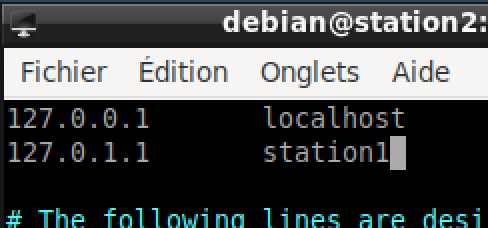

## Station2 :

On installe le serveur SSH : On change le nom de la machine :

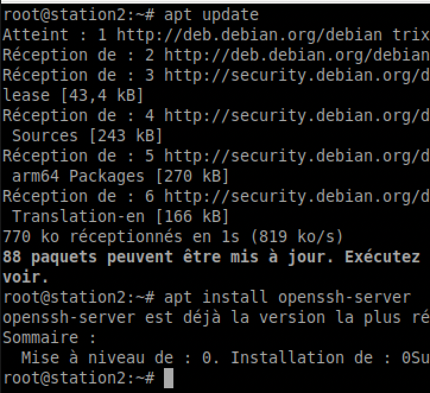

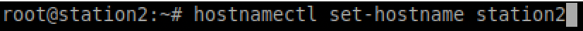

Puis on modifie /etc/hosts avec vi et on remplace debian par station2.

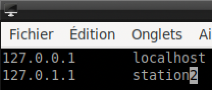

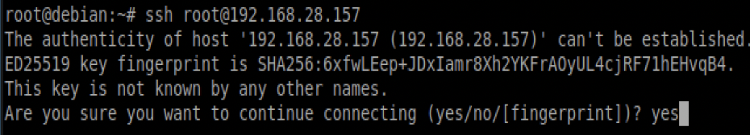

première connexion SSH de station1 vers station2

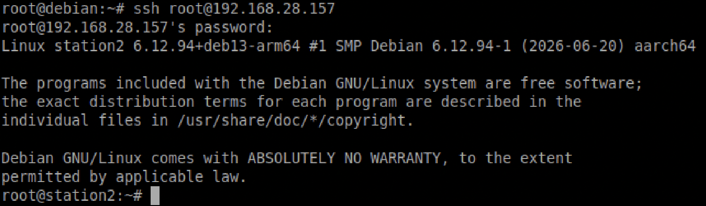

connexion SSH réussie avec le mot de passe

## 2. Authentification TOTP avec Google Authenticator

Tutoriel utilisé : https://www.it-connect.fr/linux-comment-activer-le-mfa-sur-un-acces-ssh/

On fera toutes les configurations sur station2, car c’est le serveur SSH qui vérifie le code. Le module PAM **pam_google_authenticator** calcule le code attendu à partir d’un secret partagé avec l’application.

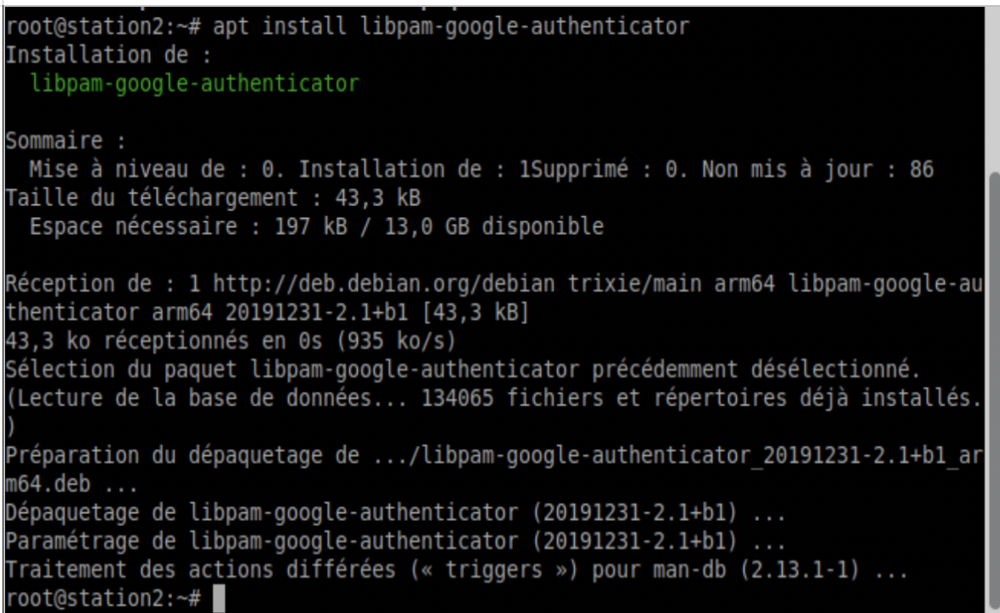

Sur station2, on installe le module :
apt install libpam-google-authenticator

Après, on génère le secret pour l’utilisateur debian : on configure le module avec la commande google-authenticator.

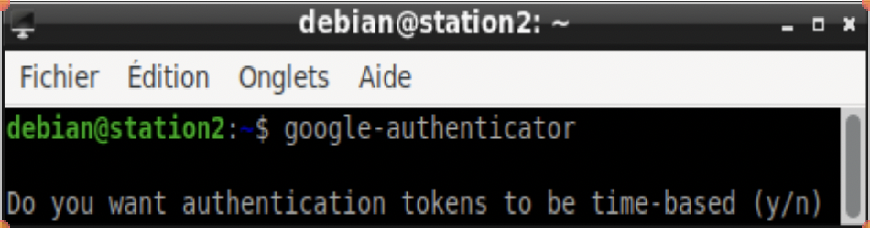

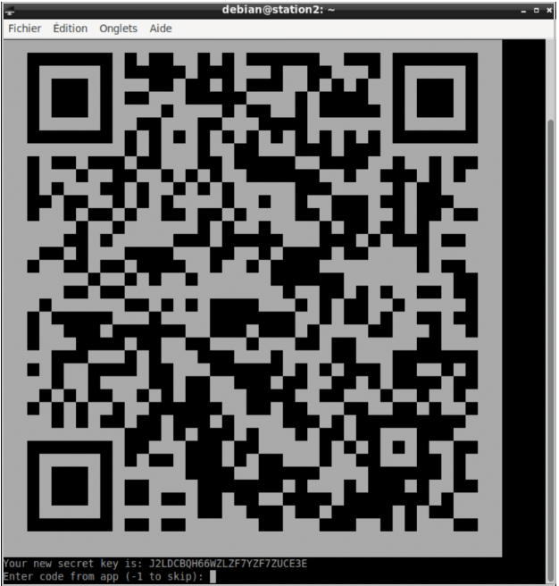

Cela va générer un QR code que l’on va scanner avec notre téléphone.

La commande google-authenticator pose ensuite plusieurs questions :

- Tokens basés sur le temps (yes)
- Mise à jour du fichier ~/.google_authenticator (yes)
- Interdire plusieurs utilisations du même code (yes)
- Augmenter la fenêtre de temps (yes)
- Limitation des tentatives (yes)

Ensuite, on active le MFA sur la connexion SSH en modifiant /etc/pam.d/sshd : on ajoute cette ligne (auth required pam_google_authenticator.so)

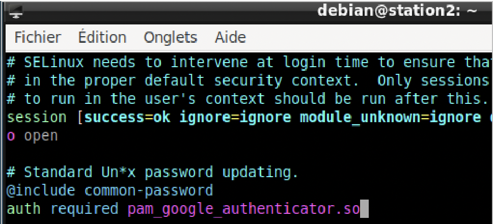

Après, on configure le serveur SSH : dans /etc/ssh/sshd_config, on met l’option KbdInteractiveAuthentication à yes (sur le site utilisé comme tutoriel, cette option porte un autre nom).

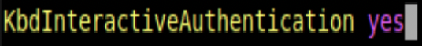

Maintenant, quand on est sur station1 et qu’on fait ssh debian@station2, on nous demande en plus le code.

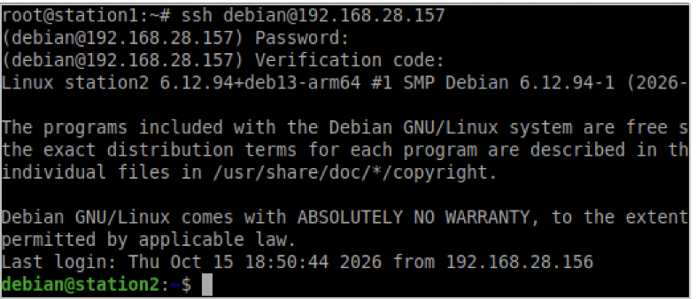

## Comparaison des 4 méthodes d’authentification
Mot de passe seul

Comme d’habitude, on fait ssh debian@station2 et on entre le mot de passe.

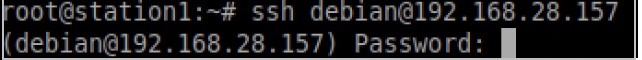

Un keylogger enregistre le mot de passe. L’attaquant se connecte.

## Mot de passe et code TOTP

Comme on vient de le faire juste avant, on utilise google_authenticator (en suivant ce tutoriel : https://www.it-connect.fr/linux-comment-activer-le-mfa-sur-un-acces-ssh/).

Même keylogger : il a le mot de passe, mais pas le code du téléphone, donc il est bloqué.

## Code TOTP seul

dans /etc/ssh/sshd_config

et /etc/pam.d/sshd.

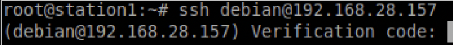

Quelqu’un vole le téléphone déverrouillé. Il a le code, donc il se connecte. Avec la méthode 2, il lui manquerait le mot de passe.

## Code TOTP ou mot de passe

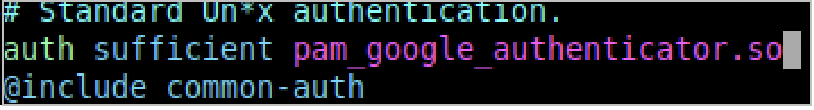

module google_authenticator en sufficient avant common-auth

le code est demandé en premier

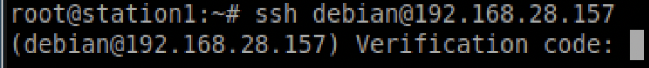

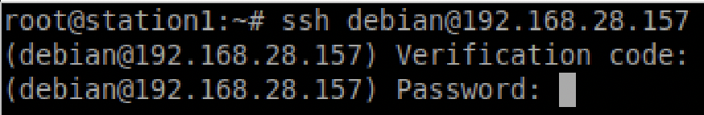

en appuyant sur Entrée, le mot de passe est demandé

L'attaquant choisit le plus facile : le keylogger suffit (méthode 1) et le vol du téléphone suffit aussi (méthode 3).

## PAM : Pluggable Authentication Modules

## Les mots-clés REQUIRED, REQUISITE et SUFFICIENT

Source : page de manuel Linux-PAM pam.conf(5) / pam.d(5), https://sites.uclouvain.be/SystInfo/manpages/man5/pam.d.5.html

**L’ordre des directives du fichier de configuration de PAM compte**

PAM lit le fichier de haut en bas, et comme REQUISITE et SUFFICIENT peuvent arrêter la lecture, déplacer une ligne peut changer complètement le résultat.
**Exemple 1**

Ici, le code est demandé en premier : s’il est bon, sufficient accepte la suite ; sinon, l’échec est ignoré et le mot de passe est demandé (configuration et résultat : voir la partie « Code TOTP ou mot de passe »).
Résultat : le code ou le mot de passe suffit.
**Exemple 2**

On utilise pour l’exemple pam_deny.so, qui est un module PAM qui refuse tout ce qu’on lui donne. On désactive le mot de passe et on met d’abord le required avec le module qui refuse, puis en dessous notre sufficient avec le module d’authentification.

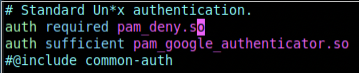

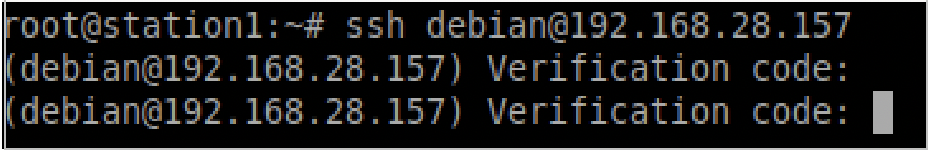

On voit qu’en mettant le bon code, l’accès est quand même refusé : l’échec du required placé au-dessus ne peut pas être annulé par la réussite du sufficient.

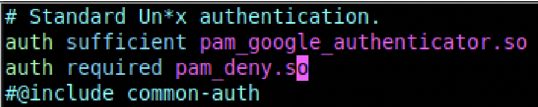

Tandis que si on inverse ces deux lignes, la connexion marche sans problème.

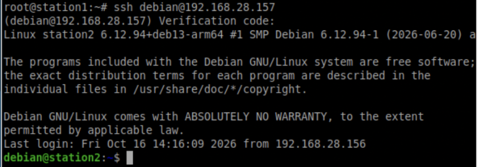

Donc oui, l’ordre compte.

*(rapport en cours de rédaction)*
