# Projet 2 — Authentification forte

## UNIVERSITÉ D'ÉVRY PARIS-SACLAY

Licence 3 : Informatique – SR

RAPPORT DE PROJET

_____________________________________________________________

## AUTHENTIFICATION FORTE

Deuxième projet réseau : TOTP, PAM et gestionnaire de mots de passe.

______________________________________________________________________________

### Réalisé par :

**HAMMOUCHE Sami** – n° étudiant : 20243631

Année universitaire 2026 – 2027

## Maquette :

La maquette est constituée de deux machines virtuelles Debian : station1 (client SSH) et station2 (serveur SSH).
Station1 :
On change le nom de la machine :

Puis on modifie /etc/hosts avec vi et on remplace debian par station1.

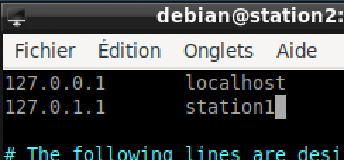

## Station2 :

On installe le serveur SSH : On change le nom de la machine :

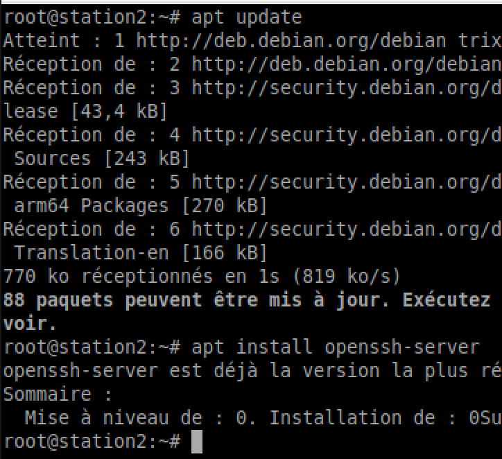

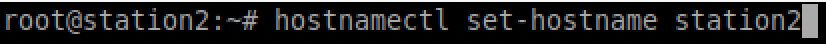

Puis on modifie /etc/hosts avec vi et on remplace debian par station2.

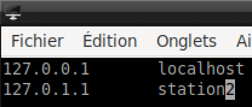

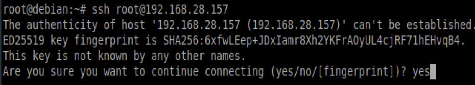

première connexion SSH de station1 vers station2

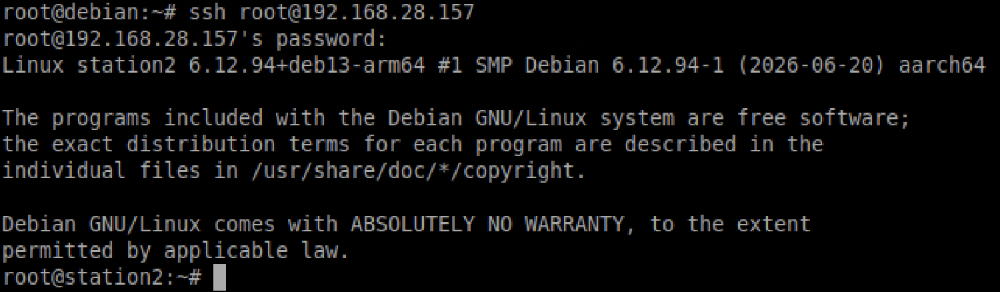

connexion SSH réussie avec le mot de passe

## 2. Authentification TOTP avec Google Authenticator

Tutoriel utilisé : https://www.it-connect.fr/linux-comment-activer-le-mfa-sur-un-acces-ssh/

On fera toutes les configurations sur station2, car c’est le serveur SSH qui vérifie le code. Le module PAM **pam_google_authenticator** calcule le code attendu à partir d’un secret partagé avec l’application.

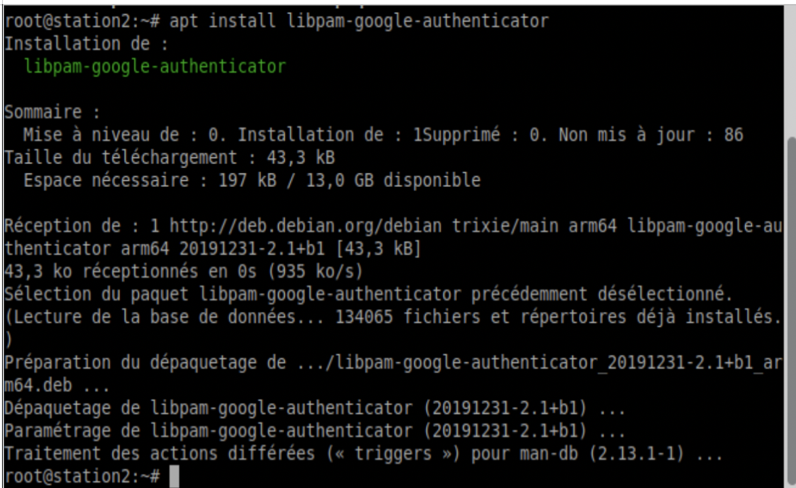

Sur station2, on installe le module :
apt install libpam-google-authenticator

Après, on génère le secret pour l’utilisateur debian : on configure le module avec la commande google-authenticator.

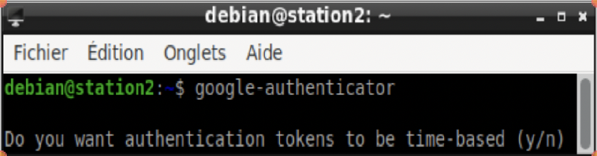

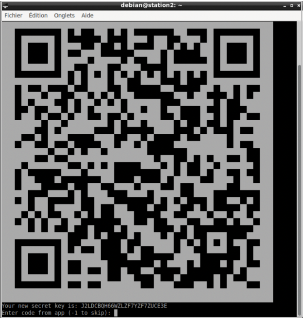

Cela va générer un QR code que l’on va scanner avec notre téléphone.

La commande google-authenticator pose ensuite plusieurs questions :

- Tokens basés sur le temps (yes)
- Mise à jour du fichier ~/.google_authenticator (yes)
- Interdire plusieurs utilisations du même code (yes)
- Augmenter la fenêtre de temps (yes)
- Limitation des tentatives (yes)

Ensuite, on active le MFA sur la connexion SSH en modifiant /etc/pam.d/sshd : on ajoute cette ligne (auth required pam_google_authenticator.so)

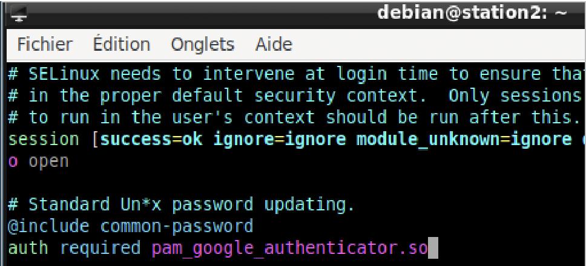

Après, on configure le serveur SSH : dans /etc/ssh/sshd_config, on met l’option KbdInteractiveAuthentication à yes (sur le site utilisé comme tutoriel, cette option porte un autre nom).

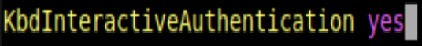

Maintenant, quand on est sur station1 et qu’on fait ssh debian@station2, on nous demande en plus le code.

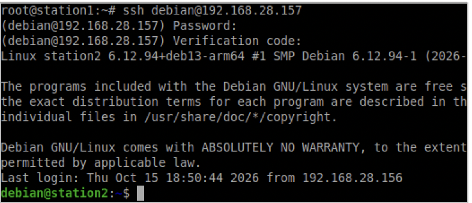

*(rapport en cours de rédaction)*
